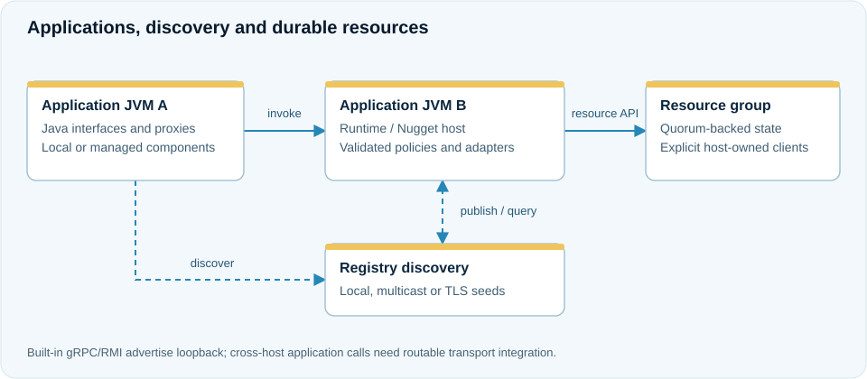

# Architecture

## Runtime, host and application

A middleware runtime exports objects, discovers references, selects transports
and dispatches calls. The application platform adds artifact verification,
activation, generated component definitions and owned invocation lifetimes.
A Nugget is the host in which these application and operational capabilities are
assembled. Multiple JVMs run independently configured hosts.

<figure class="j7m-diagram" markdown>

{target="_blank" rel="noopener"}

<figcaption markdown="span">[Open full-size SVG](../assets/diagrams/runtime-topology.svg). On small screens, scroll the diagram horizontally.</figcaption>
</figure>
The built-in service transports advertise loopback endpoints. The diagram can run
across JVMs on one machine; cross-host application invocation requires a routable
transport integration, as explained in [capability boundaries](capabilities.md).

Discovery finds a suitable reference; the transport carries a call to that
reference; the receiving runtime enforces admission and security. Optional
distributed resource groups own their replicated state. These are distinct
boundaries: finding a service does not prove that a later invocation will succeed.

## Application components

The managed profile uses generated definitions rather than unrestricted
reflection into an application's modules. The host validates configuration,
resource bindings and policy identities before accepting work. Application code
can use injection, lifecycle methods and annotated callbacks, while the host
retains control over the facilities they select.

An invocation can finish logically before its physical work has stopped. A timeout
or cancellation therefore does not immediately free a running task's resource
ownership. Drain waits for tracked physical work before the application can be
safely released. See [lifecycle](../programming/lifecycle.md).

## Optional distributed services

`j7m-distributed-core` provides quorum-backed resources, leases, fenced ownership,
replicated queues, durable jobs, sagas and retained events. The application
distributed module bridges these APIs to generated managed callbacks. The host
must explicitly install the clients, profiles and authorization required by each
feature.

Three and five voting JVMs are qualified development topologies, not a claim
that an arbitrary number of application instances automatically forms a consensus
group. Configure membership, storage, credentials and failure domains separately.

## Evidence and next steps

The public boundaries are implemented in `MiddlewareRuntime`,
`MiddlewareRuntimeBuilder`, `ApplicationManager`, `ManagedHostBindings` and the
distributed client APIs. The detailed contract is owned by those implementations
and their tests; examples throughout this manual link to the relevant sources.

[Modules](modules.md) · [Deployment topologies](../deployment/topologies.md) ·
[Distributed semantics](../reference/semantics.md)
