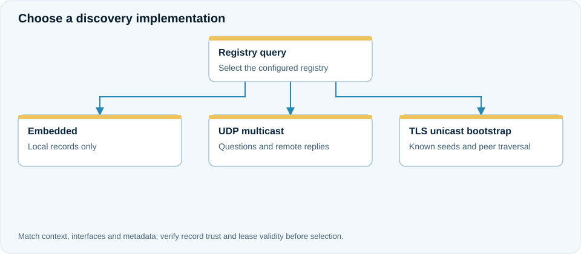

# Service discovery and dynamic dependency replacement

**Use case:** checkout instances call one of several pricing instances. A newly started JVM should become eligible, and a failed target should not remain the permanent dependency of every checkout object.

<figure class="j7m-diagram" markdown>
<div class="j7m-diagram-scroll" tabindex="0" role="region" aria-label="Discovery and target selection" markdown>

[](../assets/diagrams/discovery.svg){target="_blank" rel="noopener"}

</div>
<figcaption markdown="span">[Open full-size SVG](../assets/diagrams/discovery.svg). On small screens, scroll the diagram horizontally.</figcaption>
</figure>
J7M separates registry discovery from the stable business proxy. The host supplies a `BindingCandidateSource`, connector, contract constraints and admission policy. The built-in `PolledBindingCandidateSource` periodically repeats registry discovery; it is not an instantaneous topology notification service.

=== "With annotations"

    ```java
    @Inject
    public Checkout(@ServiceRef(name = "pricing",
            refresh = BindingRefresh.ON_FAILURE,
            policy = "pricing-client") Pricing pricing) {
        this.pricing = pricing;
    }
    ```

    `ServiceBindingFactory` resolves the generated dependency. The policy must be installed before activation.

=== "Explicit API"

    ```java
    List<ObjectRef> candidates = runtime.list(
            "pricing", List.of(Pricing.class.getName()),
            Map.of(), lookupOptions);
    Pricing exact = runtime.reference(
            candidates.getFirst(), Pricing.class, proxyOptions);
    ```

    This obtains an exact reference from the current list. An explicit application that wants continuous replacement must own a live binding/subscription and its lifecycle; repeatedly assigning an arbitrary field is not equivalent to the managed proxy contract.

## Configure the discovery path

The default embedded registry is local to its store and does not discover unrelated JVMs. Select multicast for a reachable multicast domain, or explicit unicast TLS bootstrap seeds for routed networks. Match context and record trust. See [discovery configuration](../configuration/discovery.md).

`NEVER` selects once; `ON_FAILURE` keeps a healthy target; `ON_TOPOLOGY_CHANGE` can reselect on newer authoritative snapshots. Changing a target never replays the invocation that failed. Keep retry/deduplication decisions separate.

## Failure and recovery

UNKNOWN discovery fails new calls closed. Stale generations cannot replace a newer accepted incarnation. Only qualified target/connection failures quarantine an incarnation; an ordinary business error is not proof that another instance should run the same operation.

## Worked scenario: use a network registry with an unavailable seed

An operations team configures two authenticated bootstrap seed endpoints in the [discovery configuration](../configuration/discovery.md). The first can be temporarily unavailable; the second advertises eligible registry peers. Bound traversal depth, peer contacts, candidates and total deadline. Install the network resolver with the client's TLS credentials and trusted server material; strict publication trust is a separate check.

The application consumes the admitted candidates through the same typed dependency:

```java
@J7mComponent
public final class Checkout {
    private final Pricing pricing;

    @Inject
    public Checkout(@ServiceRef(name = "pricing",
            refresh = BindingRefresh.ON_FAILURE,
            policy = "pricing-client") Pricing pricing) {
        this.pricing = pricing;
    }

    public String quote(String product) {
        return "Price: " + pricing.price(product);
    }
}
```

Assume `Pricing.price` returns a price string and the trusted host installs `pricing-client`. When the first registry seed is unreachable, traversal can reach the second and its peers within the original budget. Only records passing context, contract and publisher-trust admission become candidates. A valid TLS connection does not make every returned publication trustworthy.

A new pricing JVM can appear on a later discovery snapshot. ON_FAILURE keeps the current healthy target; ON_TOPOLOGY_CHANGE permits reevaluation when newer authoritative topology is accepted. If the selected JVM disappears, the failed invocation reports its outcome and a subsequent logical call can use a replacement. Do not resubmit an unsafe order command simply because discovery found another instance.
