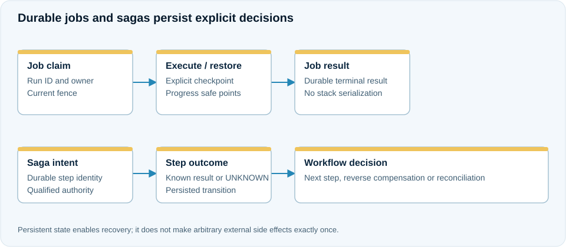

# Durable jobs, progress and checkpoint recovery

**Use case:** rebuilding a large index should survive worker loss and resume from a known checkpoint. A job result must be queryable after the initiating frontend has gone away.

<figure class="j7m-diagram" markdown>
<div class="j7m-diagram-scroll" tabindex="0" role="region" aria-label="Durable job and workflow ownership" markdown>

[](../assets/diagrams/jobs-sagas.svg){target="_blank" rel="noopener"}

</div>
<figcaption markdown="span">[Open full-size SVG](../assets/diagrams/jobs-sagas.svg). On small screens, scroll the diagram horizontally.</figcaption>
</figure>
=== "With annotations"

    ```java
    @DurableJob(value = "rebuild", policy = "index-jobs")
    public String run(String partition) {
        while (nextBatch < totalBatches) {
            if (jobContext.get().cancellationRequested()) {
                throw MiddlewareException.of(MiddlewareErrorCode.CANCELLED, "Job cancelled");
            }
            processBatch(partition, nextBatch++);
            jobContext.get().checkpoint();
        }
        return "indexed";
    }
    @Checkpoint public Integer checkpoint() { return nextBatch; }
    @Restore public void restore(Integer saved) { nextBatch = saved == null ? 0 : saved; }
    @Progress public Integer progress() { return nextBatch; }
    ```

    `jobContext` is the host-injected `ManagedProvider<ManagedJobContext>`. `processBatch` is application work and must have an external effect protocol suitable for replay/takeover; saving a counter alone does not make its external writes atomic.

=== "Explicit API"

    ```java
    ExecutionResult submitted = jobs.submit("submit-42", "rebuild-42", inputFrame, deadline);
    ExecutionResult state = jobs.status("rebuild-42", deadline);
    ```

    `jobs` is a configured `DurableJobs`. A manual worker uses its claim/renew/checkpoint/complete operations with the current owner and fence. A managed producer can instead use `ManagedJobClient.submit(logicalId, input, deadline)` without handling worker credentials.

## Recovery contract

The generated host validates callback shapes and allowed schemas before construction. Mutable per-run state requires a checkpoint/restore pair; fresh runs receive null and must reset state. The host never serializes a Java stack or arbitrary heap.

A claim is pinned to its native group/epoch. Renewal keeps the current fence. A new owner after expiry gets new authority; a retained old context cannot stage new protected effects. Native completion commits supported staged CAS effects with the result, not arbitrary external I/O.

## Cancellation and drain

Durable cancellation and logical failure are not proof that old Java exited. Workers must cooperate, and the host retains actual owned child work, finalizers and class loader until physical completion. A producer is unavailable before global admission and after drain begins.

Configure the job factory/profile, namespace, lease/renewal/budget, payload and retained-state capacity. See [distributed resources](../configuration/distributed-resources.md). Use [persistent schedules](persistent-schedules.md) for recurring occurrences.

## Worked scenario: resume an index rebuild at batch four

An index rebuild tracks the next batch as explicit application data. The complete annotated component is shown in [job annotations](../annotations/jobs-scheduling.md#example-resume-a-batch-job-from-a-safe-point). Its business loop uses the current authorized job context:

```java
while (nextBatch < 10) {
    indexStore.rebuildBatch(partition, nextBatch);
    nextBatch++;
    jobContext.get().checkpoint();
}
return partition + ":complete";
```

`indexStore` is the application's bounded, idempotent or fenced index integration; `jobContext` is its `ManagedProvider<ManagedJobContext>`. The `@Checkpoint` hook returns `nextBatch`; the `@Restore` hook resets it to zero for a fresh run or loads the saved integer for takeover.

If the first worker saves 4 and then disappears, a replacement obtains a newer fence, restores 4 and continues with batch four. It must not retain an old worker's context or write authority. A batch interrupted before its checkpoint may run again, which is why the index effect must honor the application's stable identity/fence protocol.

Clients read the durable job status and recorded result rather than starting another job merely because a completion reply was lost. A committed completion remains completed after recovery. A separate job submission requires its own intentional business identity.

This example's safe point is between batches. It does not promise stack restoration or atomicity between an unrelated index server and the checkpoint record.
