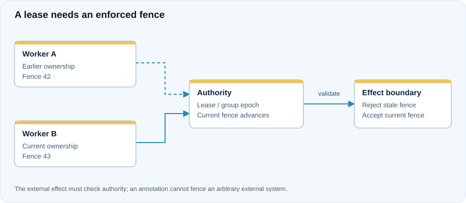

# Partitioned state, routing and ordered processing

**Use case:** account adjustments must follow the current owner of a partition and reject stale writes after handoff. A deterministic reducer is a better fit than replicating arbitrary mutable Java objects.

<figure class="j7m-diagram" markdown>
<div class="j7m-diagram-scroll" tabindex="0" role="region" aria-label="Authoritative ownership" markdown>

[](../assets/diagrams/ownership.svg){target="_blank" rel="noopener"}

</div>
<figcaption markdown="span">[Open full-size SVG](../assets/diagrams/ownership.svg). On small screens, scroll the diagram horizontally.</figcaption>
</figure>
=== "With annotations"

    ```java
    @PartitionHandler(resource = "balances", policy = "balances")
    @ShardKey("7")
    @OrderedBy("7")
    public class Balances {
        public Balances() { }
        public int initial() { return 0; }
        public int apply(int state, Adjustment command) { return state + command.delta(); }
        public int query(int state, String query) { return state; }
    }
    ```

    `Adjustment` is an allowed record whose required scalar account key has `@WireField(id=7)`. State belongs to the partition, so this integer state is not an implicit map of all accounts.

=== "Explicit API"

    ```java
    ManagedPartitionResource.Receipt receipt = balances.execute(
            "adjust-42", new Adjustment("account-7", 10), deadline);
    Integer view = balances.query("account-7", "balance", Integer.class, deadline);
    ```

    `balances` is a prepared `ManagedPartitionClient` with a host-admitted program and authoritative topology. A fully annotation-free integration implements/registers the lower-level transferable resource and encoded reducer contract explicitly.

## Reducer rules

Keep reducers deterministic, bounded and free of external I/O, mutable static state, threads or ambient invocation context. Query receives independently decoded state; rejected commands and query mutation must not change the live encoded state. Generated callbacks use direct access and actual app-owned schemas.

## Order and handoff

`@OrderedBy` matches the shard selector. Persisted tickets and terminal receipts preserve first-commit order across retry and restart. Per-key order is a subsequence of partition order, not global FIFO.

Each live request names the expected group/epoch. Handoff transfers encoded state, receipt history and cursor; the old source remains fenced. Retrying identical business identity/data returns historical evidence, which is not fresh write authority.

Configure native peer/storage/TLS identities, original voter seed, program fingerprint, resource scope and finite retention. See [deployment topologies](../deployment/topologies.md).

## Worked scenario: apply adjustments across an owner handoff

The application uses the `Adjustment` schema with account field ID 7 and the admitted `Balances` reducer above. Its prepared `ManagedPartitionClient` supplies authoritative routing:

```java
var credited = balances.execute(
        "credit:account-7:42", new Adjustment("account-7", 10), deadline);
Integer current = balances.query(
        "account-7", "balance", Integer.class, deadline);
System.out.println("Balance: " + current);
```

With a fresh single-account partition, the query returns 10. This reducer stores one integer per partition, so it is appropriate only where the host's partition model matches that state interpretation; it is not an implicit map of every account.

An authorized handoff transfers encoded state together with terminal receipts and ordering history. The application keeps the original request identity when confirming an uncertain adjustment:

```java
var historical = balances.execute(
        "credit:account-7:42", new Adjustment("account-7", 10), deadline);
```

If that adjustment committed before handoff, this obtains its historical receipt rather than adding ten again. A new adjustment requires a new intentional identity. New writes name the current authoritative group/epoch; an old group's receipt is evidence of past work, not current write authority.

After owner restart, query the restored state and recover requests under the same admitted program fingerprint. Do not bypass a frozen source or a group mismatch by sending an old encoded frame to whichever endpoint responds.
