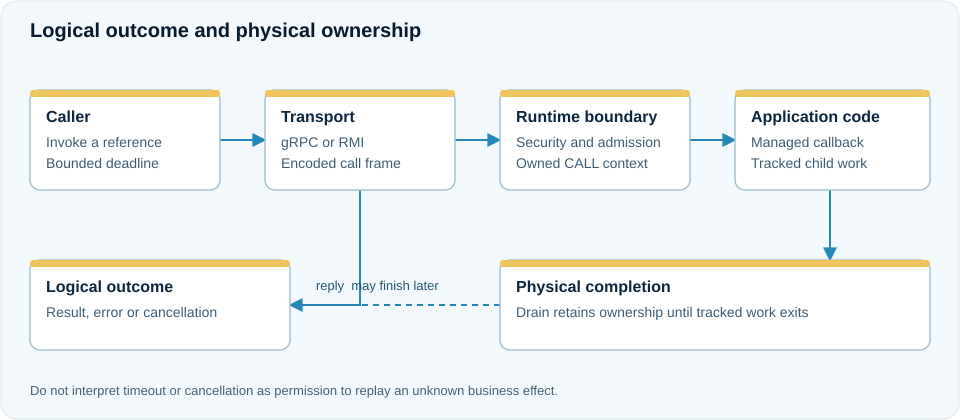

# Request–reply and remote object references

**Use case:** an order frontend reads a price or obtains a reference to an order-specific remote object. Choose a small interface with bounded data values and a clear owner.

<figure class="j7m-diagram" markdown>
<div class="j7m-diagram-scroll" tabindex="0" role="region" aria-label="Invocation boundary" markdown>

[](../assets/diagrams/invocation.svg){target="_blank" rel="noopener"}

</div>
<figcaption markdown="span">[Open full-size SVG](../assets/diagrams/invocation.svg). On small screens, scroll the diagram horizontally.</figcaption>
</figure>
=== "With annotations"

    ```java
    @RemoteService
    public interface Pricing {
        @RemoteMethod
        @Deadline(millis = 750)
        long price(String product);
    }
    ```

    A managed service implementation and its generated metadata are admitted and exported by the application host.

=== "Explicit API"

    ```java
    try (ObjectRegistration<Pricing> exported = runtime.export(
            "pricing", implementation, Pricing.class, exportOptions)) {
        Pricing pricing = caller.lookup("pricing", Pricing.class, lookupOptions);
        long amount = pricing.price("book");
    }
    ```

    The runtime owns the export and proxy behavior. Closing the registration withdraws that export; closing the runtime releases its owned transport and registry resources.

## Service name or exact reference?

Use a logical service lookup when any eligible instance may answer. Use `runtime.reference(ref, Pricing.class, proxyOptions)` when the operation must address a concrete runtime/object incarnation. A returned reference is a remote object identity, not copied application state or proof of authorization.

## Configure and verify

Install a transport that is reachable through its advertised address, an appropriate registry path and authenticated server policy. Public interface visibility and codec allowlists still apply. See [transports](../configuration/transports.md).

After a lost reply, a side-effecting operation may have executed. Do not assume a timeout means no effect. Introduce a stable business key and [durable deduplication](deduplication.md) where the application needs a recorded repeat result.

## Worked scenario: display a selected service's reply

The runnable manual application creates `server` and `client` runtimes with actual gRPC providers. They share one embedded registry store in one JVM. This isolates the invocation example from network discovery setup.

```java
var options = new ExportOptions(false, "grpc", "default", List.of(),
        Map.of("region", "local"), null, null);
try (var registration = server.export(
        "greetings", new GreetingService(), GreetingApi.class, options)) {
    GreetingApi greeting = client.lookup(
            "greetings", GreetingApi.class, LookupOptions.defaults());
    String message = greeting.greet("Ada", callback);
    System.out.println(message);
}
```

`GreetingService` implements `greet` by returning `"Hello, " + name` and invoking the supplied listener. The [callback example](callbacks.md) defines that listener. The client displays `Hello, Ada`. Closing the registration withdraws the export; it must remain alive for calls through that object.

Apply filters before invoking rather than silently selecting another region:

```java
List<ObjectRef> matches = client.list("greetings",
        List.of(GreetingApi.class.getName()), Map.of("region", "other"),
        LookupOptions.defaults());
if (matches.isEmpty()) {
    System.out.println("No greeting service in the requested region");
}
```

The only export advertises `region=local`, so this branch reports that no matching service exists. Metadata selection remains separate from server authorization.

Run the complete application from the repository root:

```shell
./gradlew -I documentation/examples/compile.init.gradle documentationRunRuntime
```

Expected output includes `RuntimeExample OK: two runtimes, actual gRPC, callback, filtered discovery`. The application uses isolated development security; configure production TLS and discovery separately.
