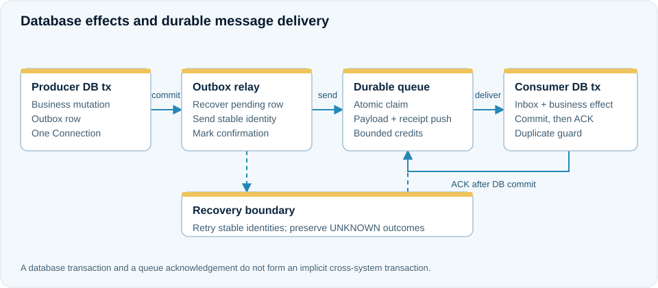

# Durable queues and competing consumers

**Use case:** several workers process image, invoice or import commands, with takeover after a worker disappears. Use a stable message identity and let a durable receipt authorize settlement.

<figure class="j7m-diagram" markdown>
<div class="j7m-diagram-scroll" tabindex="0" role="region" aria-label="Claimed delivery and settlement" markdown>

[](../assets/diagrams/delivery.svg){target="_blank" rel="noopener"}

</div>
<figcaption markdown="span">[Open full-size SVG](../assets/diagrams/delivery.svg). On small screens, scroll the diagram horizontally.</figcaption>
</figure>
=== "With annotations"

    ```java
    public interface ImageMessages {
        @QueuePublisher(queue = "images", policy = "image-producer")
        long publish(String stableId, ImageCommand command);
    }

    @DurableQueueConsumer(queue = "images", value = "resize", policy = "image-workers")
    public void receive(ImageCommand command) {
        imageService.resize(command);
    }
    ```

    The host binds the authorized producer interface and managed consumer factory. It supplies the queue/D12 or inbox strategy and the actual payload schema.

=== "Explicit API"

    ```java
    String result = queue.send("publish-42", "images", "image-42",
            encodedCommand, 3, deadline);
    try (QueueSession session = queue.subscribe(
            "images", "workers", "worker-a", 30_000, deadline)) {
        session.subscribe(subscriber);
        applicationLifetime.awaitShutdown();
    }
    ```

    `queue` is a configured `ReplicatedQueue`. An explicit subscriber receives complete `QueueDelivery` values and must own settlement, visibility and shutdown correctly.

## Configure the worker contract

Select group/member identity, finite concurrency, visibility/renewal bounds, poison attempts, source scope, namespace, schema allowlist and authenticated endpoints. The managed consumer factory must also be the exact required replay policy instance. See [distributed resources](../configuration/distributed-resources.md).

Native push atomically claims and delivers full payload, message ID, sequence, member/generation and receipt. It does not reserve work and wait for a client fetch. Idle subscriptions do not journal empty polling results.

## Delivery is not an external transaction

A duplicate delivery may occur after connection loss or restart. The managed external guard prevents blind repeated entry when its durable outcome is uncertain; INBOX provides a same-Connection SQL boundary. Neither makes arbitrary external I/O exactly once.

ACK follows physical completion and a known durable outcome. Receipt/generation fencing rejects stale settlement and visibility renewal. If a handler performs an uncertain external effect, expose UNKNOWN and reconcile rather than invent a new message identity.

## Worked scenario: restart before ACK {#worked-scenario-restart-before-ack}

A warehouse worker subscribes with bounded demand and receives a complete `QueueDelivery`. It processes the payload under its application idempotency/inbox protocol, then settles the exact grant:

```java
String outcome = queue.ack(
        "ack:" + delivery.messageId() + ":" + delivery.receipt(),
        delivery.queue(), delivery.group(), delivery.member(),
        delivery.generation(), delivery.messageId(), delivery.receipt(),
        deadline);
if ("ACKED".equals(outcome)) {
    System.out.println("Work confirmed");
} else {
    System.out.println("Delivery authority changed: " + outcome);
}
```

`queue` is the authenticated `ReplicatedQueue` facade, `delivery` came from its credit-controlled session, and `deadline` bounds settlement. STALE_GENERATION or STALE_DELIVERY is not success; the old grant cannot acknowledge a newer owner's work.

Suppose the broker group restarts while an unacknowledged membership/visibility lease remains valid. Reconnect using the same authorized member identity. The session can resume that same payload, message ID, sequence, generation and receipt. Do not publish another message simply because the delivery connection was lost.

If visibility has expired and a newer claim exists, the earlier receipt loses authority. A previous worker may already have entered its business operation, so redelivery still needs a durable inbox or equivalent duplicate-safe effect protocol.

After a lost ACK reply, confirm/repeat the same stable ACK request for that grant according to the native recovery contract. Requesting more Flow demand or closing a session is not an ACK.

A smaller local API application is available:

```shell
./gradlew -I documentation/examples/compile.init.gradle documentationRunQueue
```

It illustrates reducer/receipt/snapshot behavior in a local profile; it does not start a multi-JVM durable queue deployment. See [bounded demand](streaming-backpressure.md) and [inbox/outbox](inbox-outbox.md).
