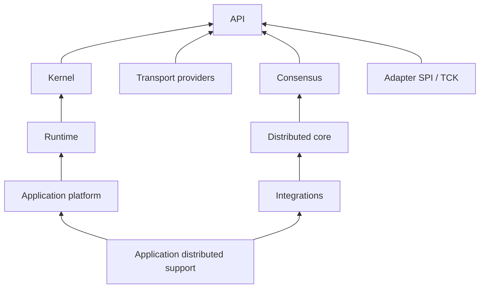

# Module dependencies and provider boundaries

Use `org.j7m.api` for application contracts. Add implementation modules at the host boundary, where transports, persistence, lifecycle and security resources are assembled. Java Platform Module System (JPMS) readability and exports remain part of the boundary; annotations do not bypass them.

## Current module map

The table lists direct J7M module requirements from the current `module-info.java` descriptors. Standard Java and external library requirements are omitted here; `transitive` requirements also make their public APIs readable to consumers.

| Gradle module | JPMS name | Direct J7M requirements |
| --- | --- | --- |
| `j7m-api` | `org.j7m.api` | None |
| `j7m-kernel` | `org.j7m.kernel` | api |
| `j7m-runtime` | `org.j7m.runtime` | api, kernel |
| `j7m-transport-grpc` | `org.j7m.transport.grpc` | api |
| `j7m-transport-rmi` | `org.j7m.transport.rmi` | api |
| `j7m-durable-log` | `org.j7m.durablelog` | api |
| `j7m-messaging` | `org.j7m.messaging` | api, durablelog |
| `j7m-coordination` | `org.j7m.coordination` | api, durablelog |
| `j7m-consensus` | `org.j7m.consensus` | api, durablelog |
| `j7m-saga` | `org.j7m.saga` | api, durablelog, messaging |
| `j7m-isolation` | `org.j7m.isolation` | api |
| `j7m-distributed-core` | `org.j7m.distributed.core` | consensus |
| `j7m-integrations` | `org.j7m.integrations` | distributed.core |
| `j7m-application-platform` | `org.j7m.application.platform` | api, runtime, durablelog, kernel |
| `j7m-application-distributed` | `org.j7m.application.distributed` | api, application.platform, distributed.core, integrations |
| `j7m-cluster-management` | `org.j7m.cluster.management` | distributed.core, application.platform, integrations |
| `j7m-adapter-spi` | `org.j7m.adapter.spi` | api |
| `j7m-adapter-tck` | `org.j7m.adapter.tck` | api, adapter.spi |
| `j7m-annotation-processor` | `org.j7m.annotation.processor` | api |
| `j7m-deployer-cli` | `org.j7m.deployer.cli` | api, application.platform |
| `j7m-testkit` | `org.j7m.testkit` | api |
| `j7m-examples` | `org.j7m.examples` | api |

In the last column, short names are suffixes of `org.j7m.`. Artifact names and JPMS names are not interchangeable; notably `j7m-durable-log` declares `org.j7m.durablelog`.



This diagram is a simplified reading guide; the table is the complete direct J7M descriptor map. Dependencies do not automatically start listeners, create durable resources or activate distributed services.

## Service loading and generated metadata

The runtime uses `TransportProvider`; gRPC and RMI modules provide implementations. The kernel provides `ValueCodec`. The public API and application host use `SchemaIndex`; the application platform also uses `ManagedComponentIndex`. The annotation processor provides `javax.annotation.processing.Processor` and generates application metadata at compilation. The CLI uses its `NuggetCliClientProvider` extension point.

An application module typically starts with:

```java
module com.example.orders {
    requires org.j7m.api;
    exports com.example.orders.api;
}
```

Add only the readability, exports and provider declarations required by that application's generated adapters and schemas. Configure annotation processing separately in the build. Do not broadly open implementation packages to compensate for missing metadata. See [schemas and JPMS](schemas-jpms.md) and the [annotation catalog](../annotations/index.md).

For extension authors, vendor libraries belong behind their adapter/provider boundary. The [adapter TCK](adapters.md) evaluates semantic behavior; JPMS readability alone does not prove it.
